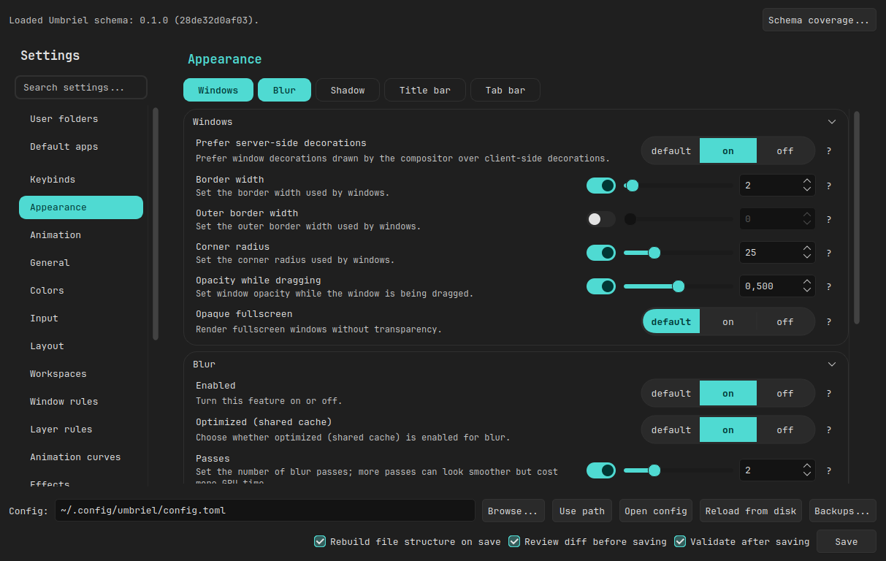

# Umbriel Settings

A desktop app for editing an Umbriel TOML config, keeping existing comments and formatting where possible.



## Features

- General, appearance, colors, animation, input, layout and workspace settings
- Keybinds with custom groups, filtering, bulk locking and action help
- Animation curves, effect presets and pools; outputs, rules, scratchpads, input-device overrides and environment variables
- XDG user folders, default applications and MIME associations
- Sliders for bounded settings, using installed Umbriel schema ranges when available
- Installed or custom cursor themes; **Schema coverage...** compares fields with the installed schema

Cursor themes are discovered when opening Input using `XCURSOR_PATH`, or
`~/.icons`, XDG icon directories and `/usr/share/pixmaps` if unset. Reopen the
app to pick up newly installed themes.

## Desktop settings

The GUI also edits:

- **User folders** (Desktop, Documents, Downloads, Pictures, ...): `~/.config/user-dirs.dirs`
- **Default applications** (browser, file manager, MIME types, ...): the `[Default Applications]` section of `~/.config/mimeapps.list`

`$XDG_CONFIG_HOME` is respected. Unrelated entries and comments are preserved,
unset options are not written, and desktop settings are saved separately after
you accept the config diff.

## Saving safely

- Review a diff before saving (on by default). External edits are detected and can be reloaded.
- Umbriel CLI validation runs after saving; disable it with the checkbox or `--no-validate`. It is skipped if Umbriel is not on `PATH`. Errors restore the previous file; warnings are reported.
- Files with GUI section banners can be regrouped on save, which may move comments. Disable **Rebuild file structure on save** to keep the layout.
- **Backups...** restores timestamped TOML backups; separately saved desktop settings are not rolled back.

GUI-only data (backups, labels, last config path) lives in `~/.local/share/umbriel-config-gui` (or `$XDG_DATA_HOME/umbriel-config-gui`); data from the old `umbriel_config_gui/data` location is migrated automatically. Custom keybind groups are stored as TOML comments, which Umbriel ignores.

## Requirements

Python 3, PySide6, tomlkit. The Umbriel CLI is optional (validation and schema comparison).

```sh
# Arch Linux
sudo pacman -S python pyside6 python-tomlkit

# Debian 13+
sudo apt install python3 python3-pyside6.qtwidgets python3-tomlkit

# Fedora
sudo dnf install python3 python3-pyside6 python3-tomlkit

# openSUSE Tumbleweed
sudo zypper install python3 python3-pyside6 python3-tomlkit

# Otherwise, use a virtual environment
python3 -m venv .venv && . .venv/bin/activate
python -m pip install -r python/requirements.txt
```

## Run

```sh
python python/umbriel-config-gui.py [path/to/config.toml]
# or
cd python && python -m umbriel_config_gui [path/to/config.toml]
```

Without a path, it opens `~/.config/umbriel/config.toml` unless another was used previously.

```text
--config PATH     Select a config file (alternative to the positional path)
--no-validate     Skip Umbriel CLI validation after saving
--no-rebuild      Do not reorganize the file when saving
--check-schema    Compare GUI fields with the installed Umbriel schema and exit
--version         Show the version and exit
```

### AppImage

Build a self-contained AppImage with Python, PySide6 and tomlkit:

```sh
appimage/build-appimage.sh        # writes dist/Umbriel-Settings-<version>-<arch>.AppImage
```

The build needs network access, `bash`, `python3` with `venv`, and FUSE (or `APPIMAGE_EXTRACT_AND_RUN=1`). Only QtCore, QtGui and QtWidgets are kept; the Umbriel CLI is looked up on `PATH`.

The Wayland desktop entry points to the AppImage itself, so keep it at a stable path (or use that path in the keybind below).

### Theming (qt6ct / Noctalia)

AppImage and pip/venv installs cannot load the system qt6ct plugin. Instead, the app reads `~/.config/qt6ct/qt6ct.conf` and applies its style (or Fusion if unavailable), font, icon theme and KDE color scheme (`color_scheme_path`, e.g. Noctalia's `noctalia.colors`). Config and scheme changes are applied while the app is open.

This only runs when `QT_QPA_PLATFORMTHEME` is `qt6ct`/`qt5ct` and Qt has not already applied the theme. Set `UMBRIEL_QT_THEME=none` to disable it or `UMBRIEL_QT_THEME=qt6ct` to force it.

The app also adjusts unreadable hint text, borders and selected labels, especially in light schemes.

### Launch with a keybind

Add to the `[keybinds]` section of your Umbriel config (or add it on the GUI's **Keybinds** page):

```toml
"Mod+Shift+C" = "spawn /usr/bin/python3 /path/to/Umbriel-GUI/python/umbriel-config-gui.py"
```

Adjust the paths (use `.venv/bin/python` if you installed in a virtual environment) and quote paths containing spaces.

### Custom icon

Replace `python/umbriel_config_gui/assets/icon.jpg` with your own JPEG and restart. If it is missing or invalid, the embedded default is used.

## Repository layout

```text
python/     Python application (launcher, umbriel_config_gui package, requirements.txt)
appimage/   AppImage build script and recipe (desktop entry, icon, entrypoint)
docs/       Screenshots
```

## License

This project is licensed under the GNU General Public License, version 3 only.
See [LICENSE](LICENSE).

> **Disclaimer:** This project was created entirely by AI.

## Related projects

- [Umbriel](https://github.com/noctalia-dev/umbriel) — the Wayland compositor whose configuration this app edits.
- [Noctalia](https://github.com/noctalia-dev/noctalia) — the desktop shell; this app can follow its color scheme.
